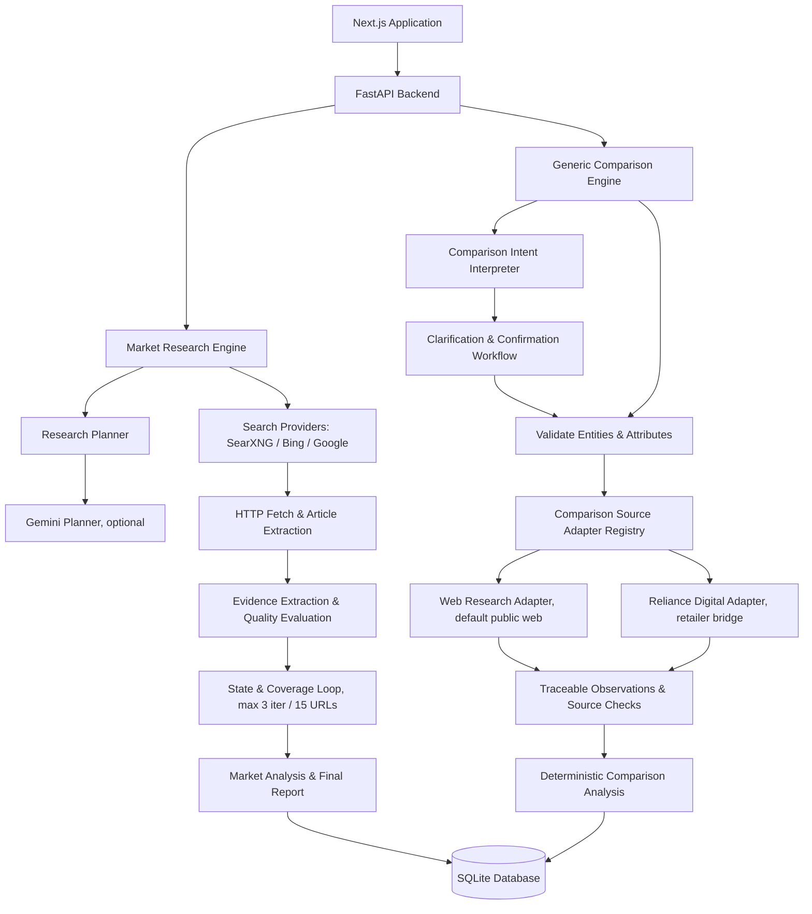

# MarketScoutAI

MarketScoutAI is an autonomous web research and market intelligence application with a separate, domain-independent comparison workflow. A user can research a market using fetched public sources and traceable evidence, or compare explicitly named entities using observations returned by selected source adapters.

The project combines a FastAPI backend, SQLite persistence, Python web-fetching and extraction tools, and a React/Next.js frontend. Gemini is an optional service used by the research planner to propose a structured plan; it is not used to generate comparison observations or comparison rankings.

## Capabilities

### Market Research

Submit a market question and follow a bounded research run. The system plans searches, discovers and fetches public pages, evaluates article-level evidence, checks requirement coverage, and may run targeted follow-up searches. It stores source metadata, evidence, activity, coverage, and the final report in SQLite.

### Generic Comparison

Submit a free-form comparison request or use structured inputs with entities, optional generic identifiers, attributes, and source preferences. Natural-language requests are interpreted into draft intents with interactive clarification and explicit confirmation. The comparison service checks registered source adapters, stores source checks and observations separately from research evidence, then produces deterministic analysis from the stored observations.

The comparison domain model does not require product-specific fields:
- **`web_research` (Default generic source)**: Discovers public pages via search, fetches readable page content, and anchors observations directly to verbatim text for category-scoped entities.
- **`reliance_digital` (Source-specific retailer adapter)**: Bridges retailer-specific product fetching, requiring explicit identifiers (`brand`, `model`, `storage`) to construct product identity.

## Architecture

The research and comparison workflows share the application shell and SQLite store, but maintain separate services, records, and result types.



## Research workflow

The research executor runs a bounded observe-and-evaluate loop:

```text
Research Request
  → Research Planner
  → Search Queries
  → Search / Fetch
  → Article Content Extraction
  → Evidence Extraction and Evaluation
  → Research State and Coverage Update
  → Follow-up Research when requirements remain missing
  → Market Analysis and Final Report
```

At each iteration, the executor searches the current queries, deduplicates URLs, fetches pages, evaluates sources, extracts candidate statements, selects evidence, and checks each information requirement against retained evidence. Missing requirements can produce targeted follow-up queries while budget remains. The report is assembled from the resulting evidence and coverage; it is not a claim that the web search was exhaustive.

### Research limits and stopping

- At most **3 research iterations** and **15 unique source URLs** per run.
- URLs and repeated query tasks are deduplicated.
- Research stops when all planned requirements are supported, when no further queries remain, when the source limit is reached, or when the iteration limit is reached.
- Search failures are skipped for that query, while page-fetch failures are attached to source records. The iteration and source limits prevent unbounded retrying.
- If the limits are reached before requirements are supported, the report preserves those gaps as unresolved / insufficient evidence.

The planner uses Gemini when `GEMINI_API_KEY` is configured and validates its structured response. If planning fails or Gemini is not configured, the planner uses a deterministic fallback plan. Some query scopes, including Indian smartphones under ₹30,000, receive a specific set of research requirements. Other questions use the planner output or fallback requirements.

### Evidence quality and scope

Search results are discovery leads. Research evidence is extracted from fetched, readable source pages, not accepted directly from a search-result snippet. Pages that cannot be fetched, have no readable content, or resolve only to a publisher homepage do not provide article evidence.

Search attempts use an optional configured SearXNG endpoint first, then Bing, direct Google search, and Google News RSS with wrapper-URL decoding as fallback. Provider access and returned results can vary.

The HTML extractor prefers article/main regions and removes common page chrome such as navigation, headers, footers, advertisements, cookie prompts, and many sidebar or news-widget regions. The evidence evaluator then applies heuristic checks, including:

- topic and product-category relevance;
- geographic relevance to the question;
- direct support for each information requirement;
- price-band and target-segment relevance where applicable;
- source class and publication date, including a claim's own year/date;
- complete, factual statement checks and rejection of obvious editorial, promotional, irrelevant, or incomplete text.

Retained research evidence keeps its exact source text and source metadata. Evidence is classified as `TARGET_SEGMENT`, `INDIA_MARKET_CONTEXT`, `GLOBAL_CONTEXT`, or `OUT_OF_SCOPE`. Broad/contextual evidence does not satisfy a direct target-segment requirement. Coverage, source quality, recency, geography, and conflict checks are heuristics; the system does not use an external reputation dataset or independently verify the original publisher's claims. Unsupported requirements remain visible as unresolved / insufficient evidence.

### Research persistence

Research data is stored in SQLite tables for runs, sources, evidence, and reports. Source rows retain discovery and fetch information; evidence rows retain the exact evidence text, source reference, publication metadata, relevance signals, and evidence scope. The default database file is `database/market_scout.sqlite3`; `MARKETSCOUT_DB` can point to another file.

## Generic comparison workflow

The generic comparison workflow supports both a natural-language interpretation path and a structured `ComparisonRequest` path. Natural-language input is interpreted on the backend into a draft intent; proposed fields remain unverified until explicitly confirmed. The structured form remains available for callers that already have resolved entities, dynamic attributes, context, and source preferences.

```text
Natural-language request (or structured input)
  → Interpret into a draft comparison intent
  → Clarify ambiguities and explicitly confirm proposed fields
  → Execute only when ready
  → Select registered source adapters (defaulting to web_research)
  → Run each selected adapter to discover and fetch public pages
  → Anchor observations strictly to fetched page text
  → Persist source checks and accepted observations in SQLite
  → Analyze persisted observations deterministically without network calls
  → Return complete ComparisonResult with matrix, summary, and unresolved details
```

The generic model separates:

| Concept | Purpose |
|---|---|
| Entity | A request-local named entity, with optional generic identifiers and aliases |
| Attribute | A requested comparison dimension (`scalar`, `range`, `categorical`, `boolean`, `structured`) |
| Source reference | The identity of a source selected for checking |
| Source check | The result and diagnostics for checking one source |
| Observation | A verified value tied to an entity, attribute, and source, backed by source URL and verbatim quote |
| Analysis | A deterministic summary derived from persisted observations |

Observations preserve both `raw_value` and `normalized_value`, along with units/currency, observation time, source URL, and optional context. Raw observations are not research `Evidence` records. Missing or conflicting values are represented as unresolved; the system does not invent values when a source fails or cannot establish an exact match.

### Natural-language interpretation and clarification

Callers can supply natural-language queries (e.g., `"Compare Kit Kat and Dairy Milk chocolate on price and quality"`). The backend comparison interpreter analyzes the input:
- **Field Provenance**: Tracks field origin as `user_provided`, `proposed`, `user_confirmed`, or `system_provided`.
- **Clarification Issues**: Identifies unresolved entity identities, missing categories, unverified attributes, or ambiguous sources.
- **Interactive Confirmation**: A clarification workflow allows users to review, edit, and confirm proposed values before any execution starts.
- **Category-Scoped Display-Name Entities**: When an explicit category context is supplied (e.g., `chocolate` or `laptop`), the system permits display-name-only entities for public web discovery without requiring manufacturer SKUs or proprietary identifiers.

### Registered comparison source adapters

The system registers two independent comparison adapters behind a unified `ComparisonSourceAdapter` interface:

1. **`web_research` (Default Generic Source Adapter)**:
   - Built-in, domain-independent public web source adapter enabled by default when no specific source is requested.
   - Discovers candidate page URLs via public search engines (SearXNG, Bing, Google, Wikipedia).
   - Fetches full HTML pages and extracts readable article text.
   - Strictly anchors observation values to readable page text containing the entity's display name or known aliases.
   - Search snippets are never accepted as observations (`search_snippets_used_as_observations: false`).
   - Extracts numeric prices with currency detection, availability states (`in stock`, `out of stock`), specifications, and textual qualities.
   - Handles network restrictions gracefully: blocked pages (HTTP 401, 403, 429, captchas) are recorded as `fetch_status: "blocked"` with diagnostic detail; source checks are marked `BLOCKED` or `PARTIAL` rather than failing the run or inventing fallback values.

2. **`reliance_digital` (Source-Specific Retailer Adapter)**:
   - Source-specific bridge around the retailer fetcher.
   - Requires explicit entity identifiers sufficient to construct product identity (`brand`, `model`, `ram`, `storage`, `variant`).
   - Uses the retailer's public product sitemap and search discovery, enforcing exact identity matching on fetched product pages before an offer becomes an observation.

### Comparison statuses

Comparison lifecycle status and source-check status describe different things:

| Scope | Values | Meaning |
|---|---|---|
| Comparison | `queued`, `running`, `completed`, `failed` | State of the overall comparison request and orchestration |
| Source check | `pending`, `checked`, `partial`, `unavailable`, `blocked`, `failed`, `unsupported` | State of an individual requested source check |

`partial` means at least one requested entity yielded accepted observations while another entity could not be fully checked. Per-entity diagnostics remain available. A completed comparison can still contain unresolved attributes or failed/unsupported source checks.

### Deterministic comparison analysis

`services/comparison_analysis.py` analyzes the persisted comparison result without network access or Gemini calls. It reports each entity's observed values and preserves source metadata:
- Missing observations and conflicting scalar observations remain unresolved; no value is selected to conceal a conflict.
- The UI renders missing values as `Not verified`.
- Shopping links ("Where to Buy") are only presented when supported by verified retailer observations (`source_type: "retailer"`); shopping links are never substituted for core comparison analysis.
- Ranking is limited to complete, safely comparable scalar numeric values when the request supplies a supported `lower_is_better` or `higher_is_better` comparison rule.

### Generic comparison persistence

Generic comparison data uses separate SQLite tables: `comparison_runs`, `comparison_entities`, `comparison_attributes`, `comparison_source_checks`, and `comparison_observations`. Observations are linked to their comparison, entity, attribute, and source check. The existing `price_comparisons`, `price_retailer_checks`, and `price_observations` tables remain the legacy compatibility path.

## API

Start the API at `http://localhost:8000`. FastAPI's interactive API documentation is available at `http://localhost:8000/docs`.

### General endpoints

| Method | Endpoint | Purpose |
|---|---|---|
| `GET` | `/` | Basic API-running response and link to API docs |
| `GET` | `/health` | Health status |

### Comparison workflow endpoints

| Method | Endpoint | Purpose |
|---|---|---|
| `POST` | `/comparison-workflows` | Starts a comparison workflow from natural language or structured input; returns workflow ID, intent, clarification state, and queued comparison ID if ready |
| `GET` | `/comparison-workflows/{workflow_id}` | Returns workflow session status, clarification questions, and linked execution status |
| `POST` | `/comparison-workflows/{workflow_id}/confirm` | Submits explicit confirmations for proposed intent fields and queues execution |
| `GET` | `/comparison-workflows/sources` | Returns the list of registered comparison source adapters |

### Research endpoints

| Method | Endpoint | Purpose |
|---|---|---|
| `POST` | `/research` | Accepts a question and queues a research run; returns HTTP 202, run ID, status, and status URL |
| `GET` | `/research/{research_id}` | Returns run details, activity, plan/coverage, evidence, and report content when available |
| `GET` | `/research/{research_id}/status` | Returns lifecycle status, iteration count, activity, update time, and error |
| `GET` | `/research/{research_id}/sources` | Returns source records and retained evidence |
| `GET` | `/research/{research_id}/report` | Returns the completed report, or 404 while no report is ready |

### Generic comparison endpoints

| Method | Endpoint | Purpose |
|---|---|---|
| `POST` | `/comparisons` | Accepts a direct generic comparison request, persists it, schedules background execution, and returns HTTP 202 with a comparison ID and status URL |
| `GET` | `/comparisons/{comparison_id}/status` | Returns comparison lifecycle status, timestamps, and errors |
| `GET` | `/comparisons/{comparison_id}` | Returns the complete result: request, entities, attributes, source checks, observations, analysis, unresolved information, errors, and timestamps |

The generic comparison lifecycle is asynchronous: submit with `POST`, poll the status endpoint while queued/running, then fetch the complete result. A requested source without a registered adapter is marked `unsupported` rather than returning invented observations.

### Legacy retailer price-comparison endpoints

The older product/retailer-specific compatibility path remains available:

| Method | Endpoint | Purpose |
|---|---|---|
| `POST` | `/price-comparisons` | Starts a legacy retailer price check |
| `GET` | `/price-comparisons/{comparison_id}/status` | Returns legacy comparison and retailer-check statuses |
| `GET` | `/price-comparisons/{comparison_id}` | Returns requested products, retailer checks, offers, and diagnostics |

This legacy contract is separate from the domain-neutral `/comparisons` API.

## Frontend

The Next.js application provides two modes in one shared interface:

- **Market Research** — submits a research question and displays run status, activity, requirements/coverage, sources, evidence, and the final report.
- **Compare** — submits a generic comparison request and displays backend analysis, entity/attribute values, unresolved information, observations, source checks, and traceable source links, timestamps, and context. The existing retailer price-check panel is also available as a separate compatibility workflow.

The generic comparison form supports multiple entities, arbitrary identifier key/value pairs, comparison attributes, and source selection. The UI does not infer identifiers or calculate its own winner/ranking. Set `NEXT_PUBLIC_API_URL` in the frontend environment to override the default backend URL (`http://localhost:8000`).

## Project structure

```text
MarketScoutAI/
├── agents/                  # Research planner and bounded executor
├── backend/                 # FastAPI application and routes
├── database/                # SQLite initialization and persistence
├── docs/                    # Documentation directory (currently empty)
├── frontend/
│   ├── app/                 # Next.js page, layout, and global styles
│   ├── components/          # Research, comparison, and price-check UI
│   ├── lib/api.ts           # Typed frontend API helpers
│   └── types/               # Research, generic comparison, and legacy types
├── models/                  # Research evidence and comparison contracts
├── services/                # Gemini planner adapter, comparison services/analysis
├── tests/
│   ├── fixtures/            # Saved retailer HTML fixtures
│   └── test_*.py            # Offline unit and API tests
├── tools/
│   ├── comparison_sources/  # Generic source contract and Reliance bridge
│   ├── retailer_fetchers/   # Legacy retailer adapters and parsing
│   ├── content_extractor.py
│   ├── web_fetcher.py
│   └── web_search*.py
├── requirements.txt
├── run.py
└── README.md
```

## Setup

### Backend

Use Python 3.10 or newer and create a virtual environment:

```powershell
cd C:\Projects\MarketScoutAI
python -m venv .venv
.venv\Scripts\Activate.ps1
python -m pip install -r requirements.txt
Copy-Item .env.example .env
```

Edit `.env` to configure `GEMINI_API_KEY` if Gemini planning is desired. `GEMINI_MODEL` defaults to `gemini-2.5-flash`. If no key is configured or the planner call fails, the research planner falls back to its deterministic plan. `SEARX_URL` is optional and configures a SearXNG search endpoint. `MARKETSCOUT_DB` is optional and changes the SQLite database path.

`googlenewsdecoder` is declared in `requirements.txt` because `tools/web_search.py` imports it for Google News RSS URL decoding.

Keep `.env` private; it is ignored by Git. `.env.example` contains placeholders only. No real credentials belong in source control or this README.

### Frontend

Use Node.js and npm. From a second terminal:

```powershell
cd C:\Projects\MarketScoutAI\frontend
npm.cmd ci
npm.cmd run dev
```

For a different backend URL, create `frontend/.env.local` and set `NEXT_PUBLIC_API_URL` to the API origin.

## Run the project

Start the backend and frontend in separate PowerShell terminals.

**Terminal 1 — FastAPI backend**

```powershell
cd C:\Projects\MarketScoutAI
.venv\Scripts\Activate.ps1
uvicorn backend.main:app --reload
```

The API normally runs at `http://localhost:8000`; API docs are at `http://localhost:8000/docs`.

**Terminal 2 — Next.js frontend**

```powershell
cd C:\Projects\MarketScoutAI\frontend
npm.cmd run dev
```

Open `http://localhost:3000`. If port 3000 is occupied, Next.js selects another available port and prints the URL in its terminal.

## Testing and validation

The deterministic automated backend suite is under `tests/` and can be run offline:

```powershell
cd C:\Projects\MarketScoutAI
.venv\Scripts\Activate.ps1
python -m unittest discover -s tests -p "test_*.py" -v
python -m compileall backend models services tools tests
pip check
```

The test suite contains **272 automated tests** covering research lifecycle and evidence evaluation, comparison intent interpretation and clarification, structured workflows, generic web research and Reliance Digital adapters, deterministic analysis, and SQLite persistence.

Frontend checks:

```powershell
cd C:\Projects\MarketScoutAI\frontend
npm.cmd run build
```

Before reviewing a change, run:

```powershell
git diff --check
```

The repository does not currently define a CI workflow. The project has been validated with deterministic backend unit tests (272/272 passing), clean Python compilation (`compileall`), clean dependency checks (`pip check`), frontend TypeScript and Next.js production builds (`npm run build`), and live end-to-end API workflows across multiple product categories.

## Validated comparison examples

1. **Chocolate Comparison (`chocolate`)**:
   - Compared **Kit Kat** and **Dairy Milk** across *Price*, *Quality*, *Availability*, and *Specifications* using the generic `web_research` source adapter.
   - Public search discovered articles across culinary, trade, and news outlets. Fetched page text was parsed and quotes were anchored strictly to page text (e.g., Afaqs, Best Media Info, Tasting Table).
   - Blocked pages (e.g., Bloomberg HTTP 403 Forbidden) were recorded as `fetch_status: "blocked"`, and unsupported attributes remained explicitly `Not verified` in the matrix without any fabricated evidence.

2. **Laptop Comparison (`laptop`)**:
   - Compared **MacBook Air M4** and **Dell XPS 13** across *Price*, *Quality*, *Availability*, and *Specifications* using the exact same generic domain-independent implementation without product-specific code.
   - Live web research extracted verified price, availability, and hardware specifications anchored to fetched CNET, Moneycontrol, and Times of India articles, with unverified qualities retained as unresolved.

3. **Autonomous Research Run**:
   - Executed live market research for *"What are the key market trends for electric two-wheelers in India in 2025?"*.
   - Evaluated candidate leads, extracted verbatim claims, checked information requirement coverage, and generated a structured final report.

4. **Reliance Digital Retailer Adapter**:
   - Validated for an explicitly identified **OnePlus Nord CE 3 Lite** and **Redmi Note 13** with explicit brand, model, and storage identifiers. The adapter enforces strict identity verification on fetched retailer pages.

## Limitations

- Public search providers and external publisher pages can change, rate-limit requests, block automated access (HTTP 401/403/429), or require client-side JavaScript. When anti-bot or paywalls block page fetching, the system records `fetch_status: "blocked"` and retains values as `Not verified` rather than inventing data.
- Registered generic comparison adapters currently include `web_research` (free public web adapter) and `reliance_digital` (source-specific retailer adapter). Other sources can be added behind the `ComparisonSourceAdapter` interface.
- Reliance Digital requires structured brand/model identifiers; it does not infer product identity from raw display names.
- The legacy price comparison remains product/retailer-specific; it is kept for backwards compatibility and is separate from the generic comparison engine.
- Comparisons and research runs execute using FastAPI background tasks in the API process. There is no durable task queue (e.g., Celery/Redis) or distributed worker.
- The API currently has no authentication or multi-tenant user isolation.
- Research source quality, relevance, coverage, and conflict decisions use rule-based heuristics. Missing requirements remain explicitly unresolved.
- Automated testing uses Python's standard `unittest` module; `pytest` is not included in dependencies.

## Roadmap

Future work, not current functionality:

- Add generic source adapters for additional public and structured data sources with offline test fixtures.
- Add durable background job execution (e.g., Celery or Temporal) and deployment configuration if moving beyond local/demo use.
- Add authentication, API tokens, and user workspace isolation.
- Expand export capabilities (CSV, PDF, JSON-LD) for generated research reports and comparison tables.

## Portfolio description

MarketScoutAI is an autonomous web research and market intelligence application built with FastAPI, Python, SQLite, and React/Next.js. Its research engine executes bounded multi-query search and observation loops, evaluates verbatim article-level evidence with heuristic relevance and quality gates, tracks requirement coverage, and compiles source-linked reports. A parallel domain-independent comparison engine provides natural-language intent interpretation with interactive clarification and structured forms, executes registered source adapters (including a generic public web research adapter and a Reliance Digital retailer bridge), anchors all observations to fetched page text, and performs deterministic, network-free comparative analysis. The system strictly adheres to factual evidence, displaying missing observations as `Not verified` and presenting shopping links only when backed by verified retailer data.
